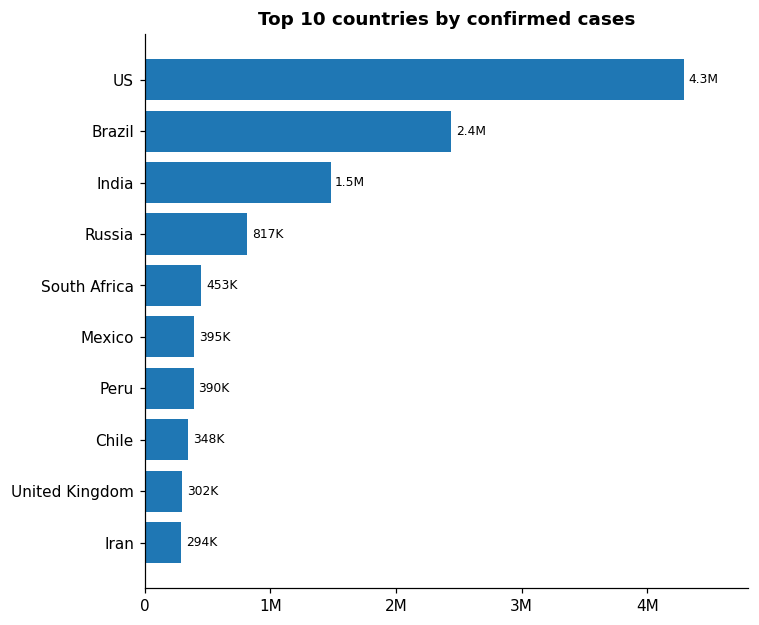
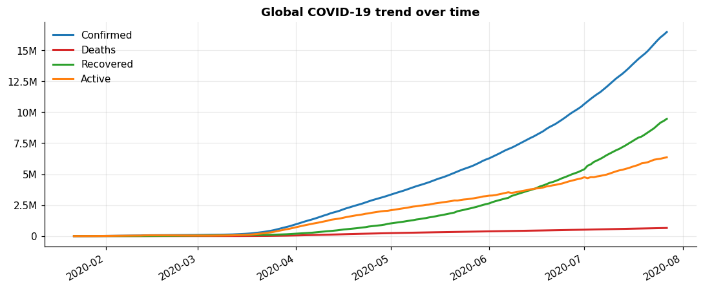
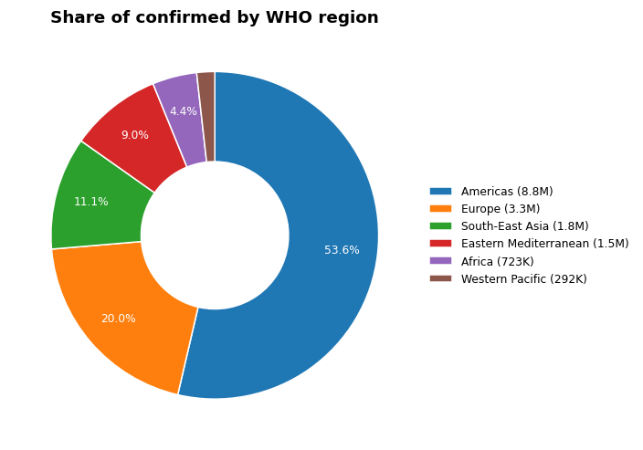

# Assignment 1: COVID-19 Dashboard

Part of [Data Analytics & Communication Assignments](../README.md).

## The assignment

> Create a dashboard using a COVID-19 dataset from [Kaggle Datasets](https://www.kaggle.com/datasets) that includes:
>
> - Bar chart
> - Line chart
> - Pie chart
>
> **Tools:** Streamlit and ReportLab.

## What I built

An interactive Streamlit dashboard on the Kaggle COVID-19 dataset (snapshot as of 27 July 2020), with a ReportLab button that exports whatever is on screen as a PDF.

| Chart | What it shows |
|---|---|
| **Bar** | Top N countries for the metric you choose (confirmed, deaths, recovered or active) |
| **Line** | Daily global trend for the selected WHO regions, with an optional log scale |
| **Pie** | Share of the chosen metric by WHO region (drawn as a donut) |

Other features:

- Four headline numbers (confirmed, deaths, recovered, active) that update with the filters.
- Sidebar filters: WHO region, metric, top N (5 to 25), which lines to show, date range.
- A data table for the top countries, hidden in an expander.
- **Download as PDF**, built with ReportLab: headline numbers, the three charts and the top-countries table.

<p>
  
  
  
</p>

A sample export is in [`../sample_outputs/covid19_dashboard_report.pdf`](../sample_outputs/covid19_dashboard_report.pdf).

## Run it

```bash
# from the repository root
pip install -r requirements.txt
streamlit run Assignment_1_COVID_Dashboard/app.py
```

Or from this folder: `pip install -r requirements.txt` then `streamlit run app.py`.

## Files

| File | Purpose |
|---|---|
| `app.py` | Streamlit page: filters, layout, download button |
| `covid_charts.py` | Data loading, the three chart functions and the ReportLab PDF builder (no Streamlit code, so it is easy to test) |
| `data/country_wise_latest.csv` | One row per country, latest totals (bar and pie charts) |
| `data/full_grouped.csv` | One row per country per day (line chart) |

## Data

Kaggle COVID-19 dataset (Johns Hopkins CSSE and Worldometer data). The figures stop at 27 July 2020, so this is a snapshot, not live data. Check the original Kaggle page for its licence terms.

## Tests

```bash
python -m unittest discover -s tests -v
```
