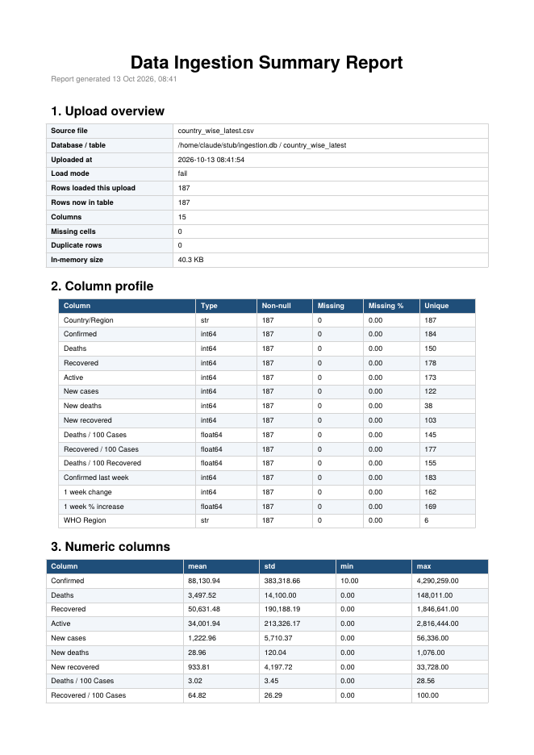

<div align="center">

# 📊 Data Analytics & Communication Assignments

**Two Streamlit apps, two PDF generators, and the storytelling skills to explain what the data means.**
From raw CSV to dashboard, database and report, then to a clear message a manager can act on.

[](https://github.com/RajdipDhar2007/data-analytics-assignments/actions/workflows/ci.yml)
[](LICENSE)


[](https://github.com/RajdipDhar2007/data-analytics-assignments/stargazers)
[](https://github.com/RajdipDhar2007)

[Dashboard](#-assignment-1--covid-19-dashboard) · [Ingestion page](#-assignment-2--csv-ingestion-page) · [Communication](#-assignments-3--4--communicating-results) · [Quick start](#-quick-start) · [Structure](#-repository-structure)

</div>

---

## ✨ What's inside

| | Project | What it does | Stack |
|---|---|---|---|
| 📈 | **[COVID-19 Dashboard](Assignment_1_COVID_Dashboard/)** | Interactive bar, line and pie charts with filters, plus a one-click PDF export | Streamlit, ReportLab |
| 🗄️ | **[CSV Ingestion Page](Assignment_2_Ingestion_Page/)** | Upload a CSV, validate it, load it into SQLite and download a profiled PDF report | Streamlit, SQLite, ReportLab |
| 🎤 | **[Explain a Result in 30 Seconds](Assignment_3_Explain_a_Result/)** | Turn recall/precision numbers into a message a non-technical manager understands | MS Word |
| 🔺 | **[Pyramid Principle & 7 Cs](Assignment_4_Pyramid_and_7Cs/)** | A structured data story and a professional email built on the 7 Cs | MS Word |

**Built with care:** unit tests for both apps, CI on Python 3.10 and 3.12, business logic separated from UI code, and clear error messages for bad input.

---

## 📈 Assignment 1 · COVID-19 Dashboard

> Create a dashboard using a COVID-19 dataset from [Kaggle](https://www.kaggle.com/datasets) with a bar chart, a line chart and a pie chart. *(Streamlit + ReportLab)*

| Bar chart | Line chart | Pie chart |
|---|---|---|
|  |  |  |

**Highlights**

- 🔎 Filter by WHO region, metric (confirmed, deaths, recovered, active), top N countries and date range
- 📉 Daily global trend with an optional log scale
- 🍩 Regional share shown as a donut
- 📄 **Download as PDF**: headline numbers, all three charts and the top-countries table

```bash
streamlit run Assignment_1_COVID_Dashboard/app.py
```

📄 [Sample PDF export](sample_outputs/covid19_dashboard_report.pdf) · 📘 [Dashboard README](Assignment_1_COVID_Dashboard/README.md)

---

## 🗄️ Assignment 2 · CSV Ingestion Page

> Create an ingestion page that handles file uploading, uploads a CSV to a database and generates a summary report using ReportLab.



**Upload → Preview → Load → Report**

- ✅ Validates files: catches empty files, bad encodings and unreadable CSVs
- 🔤 Handles UTF-8 and Latin-1, and detects the delimiter automatically
- 🗃️ Loads into SQLite with `fail`, `replace` or `append` modes and a safe, auto-cleaned table name
- 🧾 Records every load in an `ingestion_log` table
- 📑 PDF report with overview, column profile, numeric statistics, top text values and sample rows

```bash
streamlit run Assignment_2_Ingestion_Page/app.py
```

📄 [Sample PDF report](sample_outputs/ingestion_summary_country_wise_latest.pdf) · 📘 [Ingestion README](Assignment_2_Ingestion_Page/README.md)

<br clear="right">

---

## 🎤 Assignments 3 & 4 · Communicating results

Analysis only matters if people understand it. These two write-ups practise exactly that.

### Assignment 3: Explain a Result in 30 Seconds

Scenario: a churn model has **82% recall**, **69% precision** and a **70% baseline recall**. Explain what improved, the trade-off and why it matters, without saying "the algorithm is better."

> *The model now catches 82 of every 100 customers who are about to leave, up from 70. The price: roughly 3 in 10 flagged customers would have stayed anyway.*

📝 [Open the document](Assignment_3_Explain_a_Result/Assignment_3_Explain_a_Result_in_30_Seconds.docx), which includes the manager-friendly version and a peer-feedback table.

### Assignment 4: Pyramid Principle & the 7 Cs

- 🔺 **A1, Pyramid Principle:** [`Assignment_4A_Pyramid_Principle.docx`](Assignment_4_Pyramid_and_7Cs/Assignment_4A_Pyramid_Principle.docx), a case study on coding by AI, structured Headline → Supporting points → Evidence → Details.
- ✉️ **A2, 7 Cs email:** [`Assignment_4B_7Cs_Email.docx`](Assignment_4_Pyramid_and_7Cs/Assignment_4B_7Cs_Email.docx), a rescheduling email with a note on how it meets each of the 7 Cs.

---

## 🚀 Quick start

```bash
git clone https://github.com/RajdipDhar2007/data-analytics-assignments.git
cd data-analytics-assignments

python -m venv .venv
source .venv/bin/activate        # Windows: .venv\Scripts\activate
pip install -r requirements.txt

streamlit run Assignment_1_COVID_Dashboard/app.py     # Assignment 1
streamlit run Assignment_2_Ingestion_Page/app.py      # Assignment 2
```

Run the tests:

```bash
python -m unittest discover -s tests -v
```

## 🗂️ Repository structure

```
.
├── Assignment_1_COVID_Dashboard/     # Streamlit dashboard + ReportLab export
│   ├── app.py
│   ├── covid_charts.py
│   ├── data/                         # country_wise_latest.csv, full_grouped.csv
│   └── README.md
├── Assignment_2_Ingestion_Page/      # CSV -> SQLite ingestion + ReportLab report
│   ├── app.py
│   ├── ingest_core.py
│   ├── sample_data/
│   └── README.md
├── Assignment_3_Explain_a_Result/    # Word document
├── Assignment_4_Pyramid_and_7Cs/     # Word documents (4A and 4B)
├── sample_outputs/                   # example PDFs made by the two apps
├── docs/images/                      # images used in the READMEs
├── tests/                            # unit tests for both apps
├── .github/workflows/ci.yml          # runs the tests on every push
├── requirements.txt
├── LICENSE
└── .gitignore
```

## 📚 Data

The dashboard uses the COVID-19 dataset from [Kaggle Datasets](https://www.kaggle.com/datasets) (Johns Hopkins CSSE and Worldometer data, snapshot as of 27 July 2020). Only the two small files the dashboard needs are included. The data belongs to its original authors, so check the Kaggle page for its licence terms.

---

## ⭐ Found this useful?

If this repo helped you learn Streamlit, ReportLab or data storytelling, or saved you some time:

- ⭐ **[Star it](https://github.com/RajdipDhar2007/data-analytics-assignments)**: it helps other learners find it.
- 🔁 **Share it** with a classmate or colleague: [LinkedIn](https://www.linkedin.com/sharing/share-offsite/?url=https://github.com/RajdipDhar2007/data-analytics-assignments) · [X / Twitter](https://twitter.com/intent/tweet?text=Streamlit%20dashboard%2C%20CSV%20ingestion%20to%20SQLite%20and%20ReportLab%20PDF%20reports%2C%20all%20in%20one%20repo&url=https://github.com/RajdipDhar2007/data-analytics-assignments)
- 🐛 Found a bug or have an idea? [Open an issue](https://github.com/RajdipDhar2007/data-analytics-assignments/issues).

## 👤 Author

**Rajdip Dhar** · [](https://github.com/RajdipDhar2007)

## 📄 License

The code in this repository is released under the [MIT License](LICENSE).

---

<div align="center">

### ⭐ If you liked this project, please star it and share it! ⭐

Every star and share helps more learners find it. Thank you! 🙏

[⭐ Star this repo](https://github.com/RajdipDhar2007/data-analytics-assignments) · [🔁 Share on LinkedIn](https://www.linkedin.com/sharing/share-offsite/?url=https://github.com/RajdipDhar2007/data-analytics-assignments) · [🐦 Share on X](https://twitter.com/intent/tweet?text=Streamlit%20dashboard%2C%20CSV%20ingestion%20to%20SQLite%20and%20ReportLab%20PDF%20reports%2C%20all%20in%20one%20repo&url=https://github.com/RajdipDhar2007/data-analytics-assignments)

</div>
